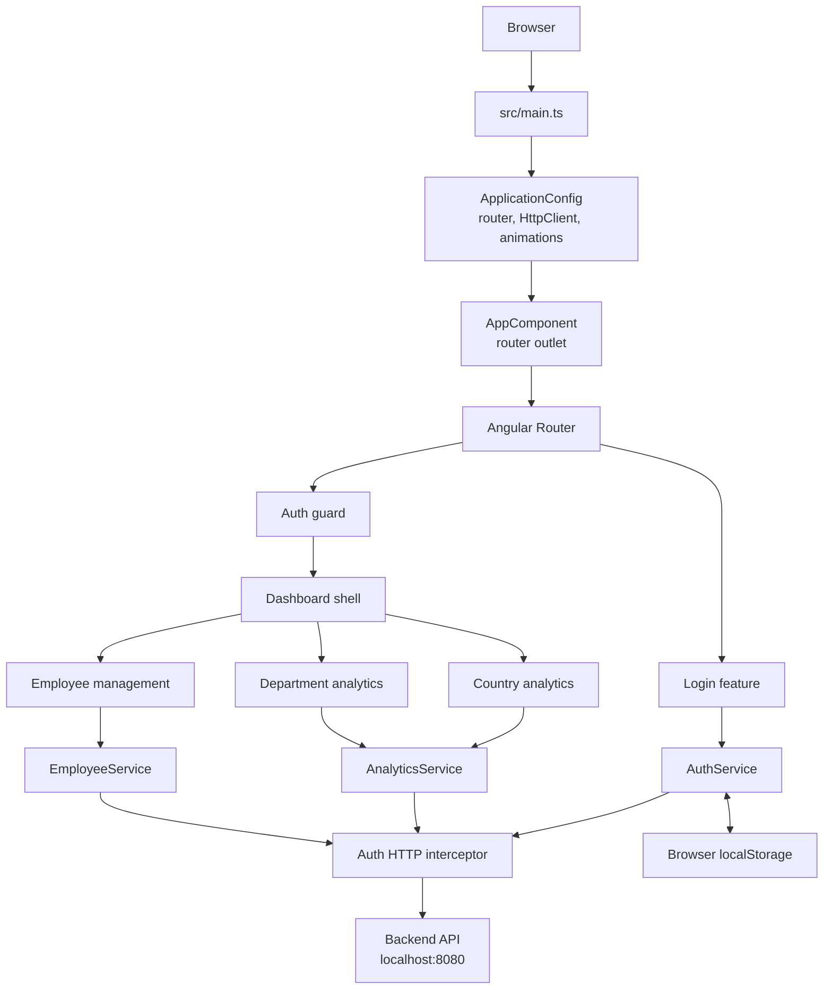

# Application Architecture

## 1. Purpose and scope

This document describes the current architecture of the Salary Management
frontend as implemented in this repository. It covers the Angular application
shell, navigation, authentication, feature areas, HTTP API integration, styling,
and development/testing setup.

The frontend depends on a separately running HTTP backend. Backend internals,
deployment topology, and API implementation details are outside this
repository's scope.

## 2. Architecture at a glance

The application is a client-rendered Angular 17 single-page application. It uses
standalone components, Angular Router lazy component loading, dependency
injection, `HttpClient`, and RxJS. The root component hosts the router; feature
components render pages and call injectable services for backend data.

## 3. Source layout

| Location | Responsibility |
| --- | --- |
| `src/main.ts` | Bootstraps the standalone root component and application providers. |
| `src/app/app.component.ts` | Root shell containing the top-level router outlet. |
| `src/app/app.config.ts` | Configures routing, `HttpClient` with the auth interceptor, and asynchronous Angular animations. |
| `src/app/app.routes.ts` | Declares public, guarded, child, redirect, and fallback routes. |
| `src/app/core/guards/` | Route access policy (`auth.guard.ts`). |
| `src/app/core/interceptors/` | Cross-cutting HTTP request behavior (`auth.interceptor.ts`). |
| `src/app/core/services/` | Singleton authentication, analytics, and employee API services, with their unit specs. |
| `src/app/feature/auth/` | Sign-in page and its presentation. |
| `src/app/feature/dashboard/` | Authenticated navigation shell and country/department analytics pages. |
| `src/app/feature/employees/` | Employee directory, detail view, create/edit form, and pagination. |
| `src/material-theme.scss`, `src/styles.css` | Angular Material theme and global styling. |
| `src/app/feature/**/**/*.css` | Feature/page-specific presentation; dashboard and employee styles are also registered as global build styles in `angular.json`. |
| `doc/` | Supporting documentation and sample response/analytics files. |

The `feature/analytics/` and `feature/salary/` directories do not currently
contain implemented source files. Salary data is represented as part of the
employee and analytics response models, but there is no separate salary
management page or salary API service in the current source tree.

## 4. Application initialization and routing

`src/main.ts` calls `bootstrapApplication(AppComponent, appConfig)`. The
application configuration registers:

- `provideRouter(routes)` for navigation.
- `provideHttpClient(withInterceptors([authInterceptor]))` for API requests.
- `provideAnimationsAsync()` for Angular Material animations.

The root component renders only a `<router-outlet />`. Routes in
`src/app/app.routes.ts` load feature components on demand using dynamic imports:

| Path | Access | Behavior |
| --- | --- | --- |
| `/login` | Public | Loads the login component. |
| `/dashboard` | Guarded | Loads the dashboard shell and redirects its empty child path to `/dashboard/country`. |
| `/dashboard/country` | Guarded | Loads country analytics. |
| `/dashboard/department` | Guarded | Loads department analytics. |
| `/dashboard/employees` | Guarded | Loads employee management. |
| `/` | Redirect | Redirects to `/dashboard`, which in turn redirects to country analytics after route activation. |
| Any unmatched path | Redirect | Redirects to `/dashboard`. |

`authGuard` checks for a token via `AuthService.getToken()`. If one exists,
navigation is allowed; otherwise, it returns a router URL tree for `/login`.
The dashboard component provides the persistent sidebar and its child router
outlet. Signing out removes the stored token and navigates to `/login`.

## 5. Core services and backend boundary

The services centralize API calls and response types. The components own
page-level presentation state and invoke these services; no global state store
is configured.

API base URLs are defined in `src/environments/environment.ts` and
`src/environments/environment.prod.ts`. Development and test builds use
`http://localhost:8080/api`; production builds replace the development file and
use the relative `/api` path. The production host must route `/api` requests to
the backend (for example, with a reverse proxy). Because the production URL is
relative to the frontend origin, it avoids embedding a deployment-specific
backend host in the browser bundle.

### Authentication

`AuthService` submits `POST /api/auth/login` with `{ username, password }`.
It accepts a token returned as a non-empty string, or as one of `token`,
`accessToken`, `access_token`, or `jwt` fields; it also recursively checks a
`data` object for those fields. A valid token is stored in browser
`localStorage` under `salary-management-auth-token`. If the response has no
usable token, the login observable errors.

`AuthService.clearToken()` removes this key. There is no separate token refresh,
expiry timer, or automatic handling of an expired session implemented in the
current frontend.

### Authorization interceptor

The functional `authInterceptor` adds an `Authorization: Bearer <token>`
header when a token is available, and only for requests matching the protected
analytics or employee API URL patterns. Requests to login and unrelated URLs
are passed through without this header. The guard and interceptor serve
different purposes: the guard controls route activation in the UI, while the
interceptor adds credentials to matching API calls.

### Analytics API

`AnalyticsService` exposes these typed GET operations:

| Method | Endpoint | Response shape |
| --- | --- | --- |
| `getSummary()` | `/api/analytics/summary` | `AnalyticsSummary`: employee totals and salary statistics by currency. |
| `getByCountry()` | `/api/analytics/by-country` | Array of country group counts and salary statistics. |
| `getByDepartment()` | `/api/analytics/by-department` | Array of department group counts and salary statistics. |

The country page loads the summary and country data together with `forkJoin`.
The department page similarly combines the summary and department data. Each
page renders loading, error/retry, and successful data states; each provides a
manual refresh action. Salary values retain their reported currency and are not
converted to a common currency by the UI.

### Employee API

`EmployeeService` exposes:

| Method | Endpoint | Behavior |
| --- | --- | --- |
| `getEmployees(page, size)` | `GET /api/employees` | Requests a page with `page`, `size`, and `sort=id` query parameters. |
| `createEmployee(employee)` | `POST /api/employees` | Sends an `EmployeePayload`. |
| `updateEmployee(id, employee)` | `PUT /api/employees/{id}` | Replaces the employee resource using an `EmployeePayload`. |

The employee page consumes the paginated response, displays a directory with
paginator controls, and provides employee details plus create/edit forms.
Client-side form validation covers required fields and email format. Successful
create/update operations refresh the relevant page. No employee delete
operation is currently exposed.

## 6. Feature responsibilities and data flow

### Sign-in

`LoginComponent` uses a reactive form with required username and password
fields. On valid submission it calls `AuthService.login()`, displays a
submitting state, and navigates to `/dashboard/country` after success. It maps
common HTTP failures (including server unavailable and unauthorized/forbidden)
to user-facing messages.

### Dashboard and analytics

`DashboardComponent` hosts the navigation links and child route content. The
country and department analytics components request their data on
initialization, derive display summaries and group-specific chart/table values,
and present the result using Angular Material cards, tables, chips, and
progress indicators.

### Employee management

`EmployeesComponent` loads its initial page on initialization. It maintains
page index/size, records, loading/error/success state, and transient form/detail
visibility in the component. Create and edit use a reactive form; employee
details are displayed from the selected record, including optional salary
information when present in the response.

## 7. UI and styling

The UI uses Angular Material components, with a light Material theme defined in
`src/material-theme.scss`. `src/styles.css` contains global resets and small
cross-page overrides. Feature templates and styles are colocated with their
components. Page-level CSS is additionally listed in the build and test style
arrays in `angular.json`, so those styles are applied globally by the current
configuration.

Templates use Angular's built-in control-flow syntax (`@if`, `@for`, and
`@empty`). The login and employee forms use Angular reactive forms. Several
templates provide semantic labels, status roles, and accessible names for
interactive controls.

## 8. Build and test architecture

The project uses Angular CLI 17.3, TypeScript 5.4, RxJS 7.8, Angular Material,
Jasmine, and Karma. It is configured as an Angular application with standalone
bootstrapping; there is no root NgModule.

- `npm start` runs the Angular development server (`ng serve`).
- `npm run build` builds to `dist/salary-management-frontend`; the default
  build configuration is production and uses the relative `/api` endpoint.
  Development builds use the `http://localhost:8080/api` endpoint.
- `npm test` runs the Karma unit-test target.
- `tsconfig.spec.json` includes `src/**/*.spec.ts`.

Unit tests are colocated with the application component and core services.
Service tests use Angular's HTTP testing providers to assert API requests and
responses without requiring a live backend.

## 9. Current architectural constraints

- The production API base URL is relative (`/api`), so the hosting server or
  reverse proxy must route API requests to the backend.
- Environment configuration is compiled into the frontend bundle and is public;
  it must not contain secrets.
- The authentication token is stored in `localStorage`, making it persistent
  across browser reloads. The frontend has no refresh-token or expiration
  handling.
- The route guard is a client-side navigation control; API authorization must
  also be enforced by the backend.
- API models are TypeScript interfaces used at compile time. `HttpClient` calls
  specify response types but do not perform runtime schema validation.
- Feature components directly coordinate page-level HTTP subscriptions and UI
  state. There is no centralized state-management library or shared error
  handling layer.
- Analytics presentation assumes salary statistics carry currency-specific
  values; comparisons across currencies are deliberately not normalized.
